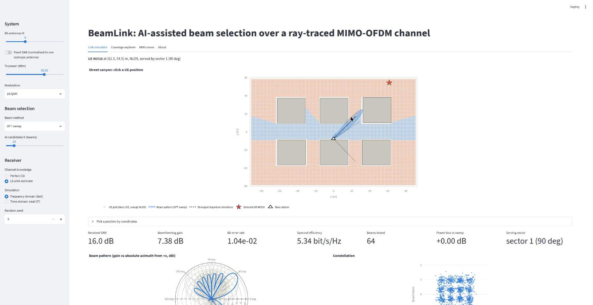
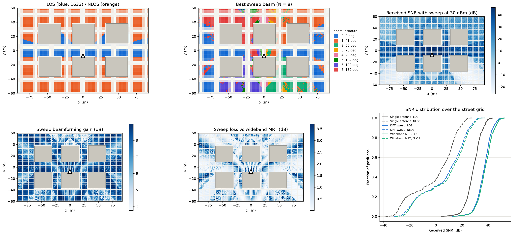
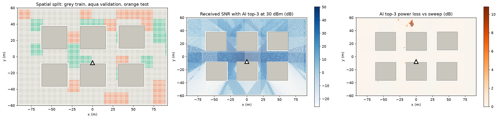
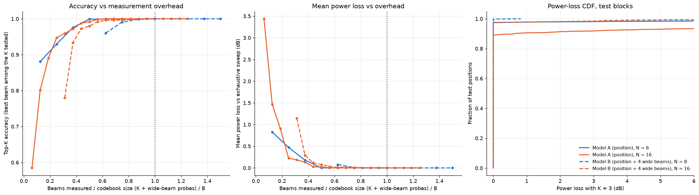
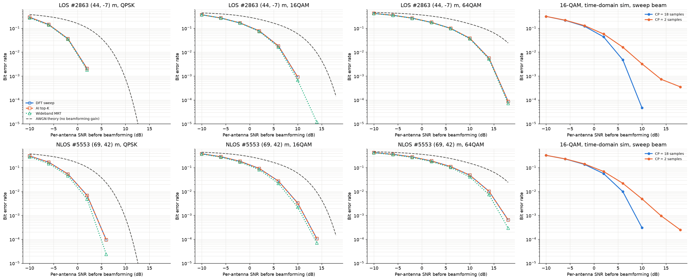
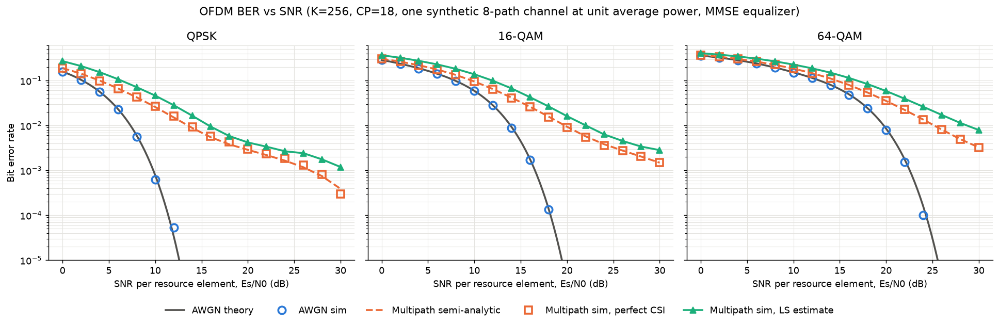
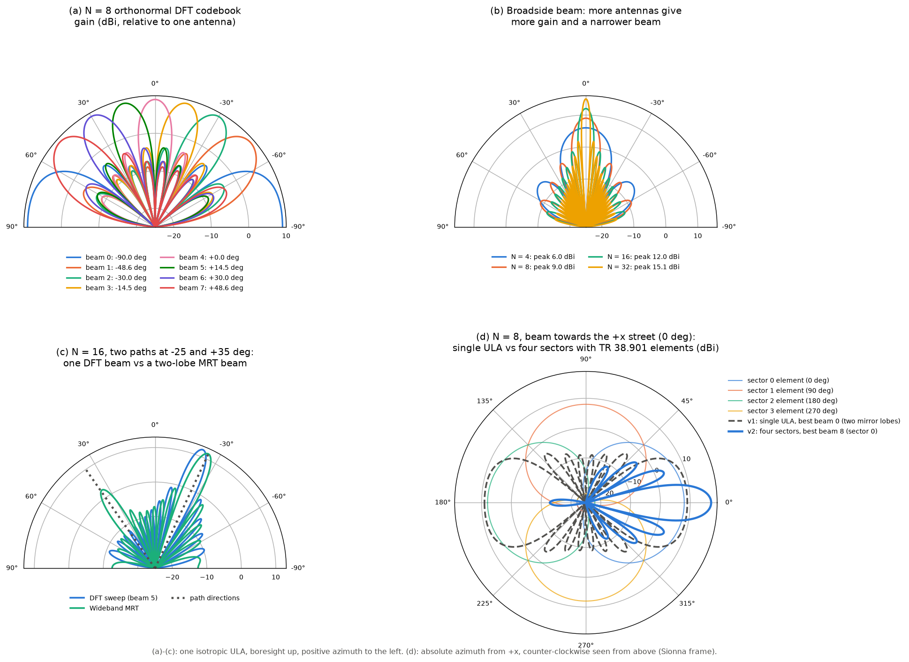
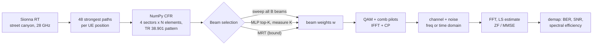

# BeamLink: AI-assisted beam selection over a ray-traced MIMO-OFDM channel

A four-sector base station serves a single-antenna user in a 28 GHz street canyon. Each sector is an N-element antenna panel with 3GPP TR 38.901 elements. The channel comes from **Sionna RT** ray tracing. Every step after that is written from scratch in **pure NumPy**: the sectored array response, DFT beam codebooks, beam sweep and MRT, OFDM with a cyclic prefix, LS channel estimation, ZF/MMSE equalization, Gray-coded QAM and the link budget. A small MLP predicts the top-K beams from the user's position, so the base station measures 10 beams instead of 64, with a mean loss of 0.02 dB on held-out streets. Everything is served from a Streamlit app that runs on a free CPU instance.

**Live demo:** TODO (link added after deployment)
**Repository:** https://github.com/abbasnawaz/beamlink



## Results

Beam prediction at N = 8 elements per sector, so 64 beams (16 per sector), evaluated on spatially held-out test blocks (1,233 positions). "Beams measured" includes the 8 wide-beam probes that Model B needs as input.

| Model | N | K | Beams measured | Overhead saved | Mean power loss | 95th-pct power loss | Sector accuracy | Adjacent-beam accuracy | Top-K accuracy | Top-1 accuracy |
|---|---|---|---|---|---|---|---|---|---|---|
| A: position only | 8 | 1 | 1 / 64 | 98% | 1.79 dB | 8.78 dB | 90.4% | 78.9% | 54.7% | 54.7% |
| A: position only | 8 | 3 | 3 / 64 | 95% | 0.59 dB | 4.68 dB | 90.4% | 78.9% | 83.3% | 54.7% |
| **A: position only (deployed)** | 8 | 10 | 10 / 64 | 84% | **0.02 dB** | **0.00 dB** | 90.4% | 78.9% | **97.6%** | 54.7% |
| A: position only | 16 | 10 | 10 / 128 | 92% | 0.32 dB | 1.67 dB | 89.1% | 70.6% | 91.1% | 50.4% |
| B: position + 8 wide beams | 8 | 3 | 11 / 64 | 83% | 0.13 dB | 0.12 dB | 92.9% | 88.5% | 94.5% | 69.7% |
| B: position + 8 wide beams | 16 | 3 | 11 / 128 | 91% | 0.37 dB | 1.61 dB | 93.7% | 83.6% | 90.3% | 55.3% |
| Baseline: the 10 most common beams | 8 | 10 | 10 / 64 | 84% | 1.11 dB | 6.45 dB | 13.9% | 0.0% | 67.6% | 0.0% |

Power loss comes first because it is the metric that matters on an oversampled codebook: a neighbouring beam is usually almost as good as the best one, so a top-1 miss often costs very little. Sector and adjacent-beam accuracy are measured on the top-1 beam: the share of test positions where it is in the best beam's sector, and where it is the best beam or its direct neighbour in that sector.

Received SNR over the whole street grid at 30 dBm with N = 8 (medians). The v1 column is the original design: one ULA with isotropic elements.

| Region | Positions | One isotropic antenna | v1 single ULA, DFT sweep | Four sectors, DFT sweep | Four sectors, wideband MRT |
|---|---|---|---|---|---|
| LOS | 1,633 | 29.0 dB | 37.2 dB | 43.7 dB | 45.4 dB |
| NLOS | 5,145 | 5.2 dB | 12.0 dB | 17.9 dB | 19.7 dB |

**NumPy vs Sionna:** for each sector, our NumPy channel is compared with Sionna RT using its `tr38901` antenna pattern, with the transmitter oriented to that sector's boresight, on 5 LOS and 5 NLOS positions. With no downtilt the relative error is at most 0.21%. With the configured 10° downtilt it is at most 2.14%, below a 3% tolerance. That extra error is polarization: Sionna rotates the vertical field of a tilted panel, which a scalar pattern cannot represent (see "Design choices" and `results/sionna_validation.png`).

| | |
|---|---|
|  |  |
| LOS/NLOS, serving sector, SNR, gain over an isotropic antenna, change vs v1, SNR CDFs | Spatial split, SNR with AI top-10, and where AI top-10 loses power |
|  |  |
| Accuracy and power loss vs measurement overhead | BER at a LOS and an NLOS test position, and the cyclic-prefix experiment |
|  |  |
| Simulated BER matches AWGN theory, and the multipath BER matches the semi-analytic curve | DFT codebook, beam width vs N, a two-path MRT beam, single ULA vs four sectors |

## Signal chain



The channel from element n of sector s on subcarrier k, and the beamformed channel the user sees, are

$$H[(s,n),k] = \sum_{\ell} \alpha_\ell\, e^{-j2\pi f_k \tau_\ell}\, g_s(\phi_\ell,\theta_\ell)\, a_{s,n}(\phi_\ell,\theta_\ell), \qquad h_{\text{eff}}[k] = \mathbf h_k^{\mathsf T}\mathbf w ,$$

where $g_s$ is the TR 38.901 element field of sector s (its pattern evaluated in the panel's own rotated frame) and $a_{s,n}$ is that panel's ULA steering vector. The 4N rows form one channel matrix, so the sweep, both MRT methods, estimation and equalization work on it unchanged.

- **Sweep:** measures `P_b = Σ_k |h_kᵀ w_b|²` for every beam. The codebook is block-structured: each sector has its own 2N oversampled DFT beams, which are zero on the other sectors' elements.
- **Wideband MRT:** the principal eigenvector of `Σ_k conj(h_k) h_kᵀ`, the best single beam for all subcarriers. It may combine several panels.
- **Per-subcarrier MRT:** `w_k = conj(h_k)/‖h_k‖`, the fully digital upper bound.

## Running locally

```bash
uv venv --python 3.12 .venv
uv pip install --python .venv/bin/python -r requirements.txt
.venv/bin/streamlit run app/streamlit_app.py
```

The app needs only `requirements.txt` (NumPy, SciPy, PyYAML, ONNX Runtime, Plotly, Streamlit and the local `beamlink` package) and the committed artifacts in `data/` (about 10 MB). It never imports Sionna or PyTorch.

Development (tests and lint):

```bash
uv pip install --python .venv/bin/python -r requirements-offline.txt
.venv/bin/python -m pytest -q
.venv/bin/ruff check . && .venv/bin/ruff format --check .
```

## Regenerating the dataset and the model

On any machine with an NVIDIA GPU, or on Colab (open `offline/generate_dataset.ipynb` with a GPU runtime; it clones the repo, installs `requirements-offline.txt`, runs `01_generate_rt_dataset.py` and the validation script, and downloads the artifacts):

```bash
python offline/01_generate_rt_dataset.py      # ray tracing, about 5 min on an RTX 4050
python offline/02_build_labels.py             # beam labels for N = 8 and 16, wide beams, spatial split
python offline/03_train_beam_predictor.py     # Models A and B for each N
python offline/04_export_onnx.py              # ONNX export with a parity check
python offline/validate_against_sionna.py     # NumPy vs Sionna CFR per sector, at 0 and 10 deg downtilt
python offline/05_evaluate.py                 # all figures in results/
```

Every script is deterministic: running it twice produces byte-identical files.

`data/beam_predictor.pt` is the PyTorch checkpoint of all four trained models (A and B, N = 8 and 16). `04_export_onnx.py` exports the deployed one from it, and `05_evaluate.py` reads it for the beam-prediction figure. The deployed app never loads it: it needs only `beam_predictor.onnx` and `norm.json`.

Versions used: Python 3.12, Sionna RT 2.2.0 (Mitsuba 3.9.1, Dr.Jit 1.5.0), PyTorch 2.15.0, ONNX 1.23.2, ONNX Runtime 1.31.1, NumPy 2.5.4, Streamlit 1.66.1, Plotly 7.1.0.

## Deployment (Streamlit Community Cloud, free)

1. Push the repository to a public GitHub repo. `requirements.txt` at the root lists only the pinned app dependencies.
2. On [share.streamlit.io](https://share.streamlit.io): **New app**, then select the repository, set the main file to `app/streamlit_app.py`, and choose **Python 3.12** under *Advanced settings*.
3. Free apps go to sleep after a period without traffic. The first visit after that wakes the app, which takes a few seconds.

## Why four sectors

The first version used one ULA with isotropic elements, facing +y from the middle of the street, so its axis ran along the street (x). Two properties of a ULA made that a poor fit:

- **Mirror symmetry.** A ULA only sees the phase step between neighbouring elements, and that step depends only on the angle to the array axis. Two directions that are mirror images about the axis give the same phase step, so the array cannot tell them apart.
- **End-fire aliasing.** Along the axis (end-fire), with half-wavelength spacing, the phase step is +π one way and −π the other, which is the same thing. A beam aimed down the street at +x also fires down −x.

Most users were along the street, so they sat near end-fire. Measured on the v1 data (N = 8): beam 0, the two-sided end-fire beam, was the best beam for 36.6% of positions. At (30, 0) the sweep reached 7.4 dB against a 9 dB array gain, because roughly half the energy went down the wrong end of the street. Rotating the array does not help, because the mirror ambiguity just moves to the new axis.

Real base stations solve this with **directional elements and sectors**, and v2 does the same:
- **Four panels.** They face the four street directions (0°, 90°, 180°, 270°) and are tilted 10° down.
- **Directional elements.** Each element uses the TR 38.901 pattern: 8 dBi peak, 65° beamwidth, 30 dB front-to-back ratio.
- **The ambiguity no longer matters.** Each panel still has its mirror ambiguity, but its elements are 30 dB weaker behind it, so a panel only "hears" its own half-plane, and the user is always served by the panel that faces it.
- **No new ray tracing.** The paths were traced once with an isotropic antenna, so the element pattern and sector geometry are applied in NumPy.

| N = 8, 30 dBm | v1: single ULA | v2: four sectors |
|---|---|---|
| Median SNR, LOS / NLOS | 37.2 / 12.0 dB | 43.7 / 17.9 dB |
| Positions without service (SNR < 0 dB) | 23.5% | 19.7% (263 gain service, none lose it) |
| Share of positions whose best beam is the single most-used beam | 36.6% (beam 0) | 7.8% |
| Sweep gain at (30, 0), against nominal | 7.4 dB of 9.0 dB | 17.8 dB of 17.0 dB (9 dB array + 8 dBi element) |
| AI: beams measured, top-K accuracy, mean loss | 3 / 8, 97.6%, 0.18 dB | 10 / 64, 97.6%, 0.02 dB |

The gain can slightly exceed the nominal 17 dB because it is measured against one isotropic antenna, which also picks up paths that cancel each other.

**Who gets worse.** 0.3% of positions lose more than 1 dB. They sit right under the mast (median 4 m away), where the user is far below the panels' horizon and a downward-looking omnidirectional antenna would do better. They still have about 43 dB.

**How the design was chosen.** Two back-to-back sectors (±x) left 18.5% of users more than 1 dB worse, mainly in the cross streets, so v2 uses four. With the orthonormal 8-beam-per-sector codebook, about 60 diagonal NLOS users between two sectors still lost 1–3.6 dB, because 45° off broadside the beam grid is coarse. Oversampling the codebook by 2 fixed that.

## Design choices worth knowing

- **Spatial train/test split.** Neighbouring grid points 1.5 m apart see almost the same channel. A random split would put near-copies of every test point in the training set and inflate accuracy. Instead the grid is cut into 15 m × 15 m blocks, and whole blocks go to train, validation or test (4,681 / 864 / 1,233 positions). Test numbers are measured on streets the model never saw.
- **48 paths per position, not 20.** In NLOS, many weak diffracted paths partly cancel each other. Keeping only the 20 strongest left more than 10% CFR error at 7% of NLOS positions, and one position came out 7–10 dB too strong. With 48 paths, the 95th-percentile NLOS error is 1.3%.
- **Per-UE ray tracing.** Sionna's default path solver isn't reproducible. Its deterministic solver is, but its results depend on which receivers share a batch, so every UE position is traced on its own.
- **Model A with K = 10 is deployed.** With 64 beams the best beam is harder to guess exactly (54.7% top-1), but the top-1 beam is in the right sector 90.4% of the time and within one beam of the best 78.9% of the time, and neighbouring beams are almost equally good. At K = 10 the AI matches v1's top-K accuracy (97.6%) while measuring 10 of 64 beams instead of 3 of 8. Only 0.2% of test users end up worse than with the v1 AI, and those are the users under the mast. Model B needs 8 wide-beam probes first (a 2-element sub-array per sector), so it costs 8 + K beams.
- **Oversampled codebook (2N beams per sector).** The codebook is no longer orthonormal, so neighbouring beams overlap. In exchange there are no gaps between beams 45° off broadside, which is where the sector boundaries are.
- **Beamforming gain is measured against one isotropic antenna.** It therefore includes the 8 dBi element gain as well as the array gain. Fixed-SNR mode scales the channel so that one isotropic antenna receives unit power.
- **Polarization in the validation.** Sionna's tilted TR 38.901 panel radiates a field that is rotated by the TR 38.901 polarization angle ψ (eq. 7.1-15). Our scalar model, like the pattern formula itself, keeps the field vertical. With a 0° tilt the two agree to 0.21%. At 10° a tilted isotropic antenna alone already differs by up to 3.3%, and the directional pattern reduces that to 2.14% because it suppresses the side paths where ψ is largest. The tilted check uses a 3% tolerance, which is about 0.26 dB.
- **ONNX parity is relative.** Logits reach about 70, where float32 resolution is about 8×10⁻⁶. The export check therefore requires `max|Δ| / max|logit| ≤ 10⁻⁵` (measured: 1.6×10⁻⁷) and identical top-10 beams on 1,000 samples.

## Conventions

- **Angles.** Azimuth φ is measured in the horizontal plane from +x towards +y; zenith θ from +z (the Sionna RT frame).
- **Array.** Sector s faces boresight azimuth φ_s. Its N elements lie on the axis (−sin φ_s, cos φ_s, 0), centred on the BS with half-wavelength spacing. The rows of the channel are ordered sector by sector.
- **Element pattern.** TR 38.901 Table 7.3-1 in the panel's local frame. The panel is rotated by R = Rz(φ_s)·Ry(β) with downtilt β > 0 pointing down, the same rotation as Sionna's `orientation`. Tilting about the array axis leaves the steering vector unchanged.
- **Steering vector.** `a_n(φ,θ) = exp(+j2π(d/λ)(n − (N−1)/2) sinθ sin(φ − φ_b))`.
- **Beamforming.** `h_eff = hᵀw` with unit-norm `w`. A beam towards φ0 is `conj(a(φ0))/√N`.
- **Codebook.** Each sector has a full-range DFT codebook with 2N beams. Global beam b belongs to sector b // 2N. Beam 0 of each sector is its end-fire beam (±90° from boresight).
- **Stored gains.** The dataset stores baseband path gains `a·exp(−j2πf_cτ)`, where `a` is Sionna's passband coefficient. Delays are aligned to the first arrival inside the link (receiver timing sync).
- **Time-domain channel.** CIR taps come from band-limited sinc interpolation, with 4 taps kept before the first arrival and 4 after the last.
- **Fixed-SNR mode.** The channel is scaled so that one isotropic antenna receives unit power, so the SNR is measured before beamforming and the gain (element plus array) shows up as a shift of the BER curve. Link-budget mode uses the raw ray-traced gains (path loss included) with a −174 dBm/Hz + 10·log₁₀(B) + 7 dB noise floor.

## Limitations and future work

- **Static and simple:** the channel is static within a slot, with a single user and a single BS. Elements are vertically polarised, and the pattern is a scalar, so the polarization rotation of a tilted panel is ignored (worth at most about 0.26 dB here).
- **One scene:** the model has learned this street, not streets in general.
- **Idealised measurements:** beam measurements are noiseless, and the AI method is offered only at N = 8 (the exported model). Users directly under the mast lose a few dB against an omnidirectional antenna, which a dedicated downward-looking element would fix.
- **Future work:** a moving UE with beam tracking and a small recurrent predictor; two users with zero-forcing precoding; LMMSE vs LS channel estimation; comparing the ray-traced channel with a 3GPP CDL model.
