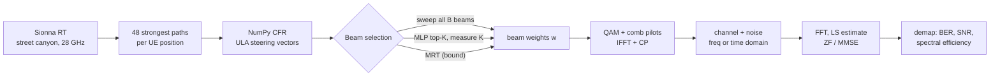

# BeamLink: AI-assisted beam selection over a ray-traced MIMO-OFDM channel

A base station with an N-element antenna array serves a single-antenna user in a 28 GHz street canyon. The channel comes from **Sionna RT** ray tracing. Every step after that is written from scratch in **pure NumPy**: array steering, DFT beam codebooks, beam sweep and MRT, OFDM with a cyclic prefix, LS channel estimation, ZF/MMSE equalization, Gray-coded QAM and the link budget. A small MLP predicts the top-K beams from the user's position, so the base station measures 3 beams instead of 8, at a mean cost of 0.18 dB on held-out streets. Everything is served from a Streamlit app that runs on a free CPU instance.

**Live demo:** TODO (link added after deployment)
**Repository:** TODO (GitHub URL added after the first push)


## Results

Beam prediction, evaluated on spatially held-out test blocks (1,233 positions). "Beams measured" includes the 4 wide-beam probes that Model B needs as input.

| Model | N | K | Beams measured | Overhead saved | Top-K accuracy | Mean power loss | 95th-pct power loss |
|---|---|---|---|---|---|---|---|
| **A: position only (deployed)** | 8 | 1 | 1 / 8 | 88% | 88.1% | 0.83 dB | 7.97 dB |
| **A: position only (deployed)** | 8 | 3 | 3 / 8 | 62% | **97.6%** | **0.18 dB** | **0.00 dB** |
| A: position only | 16 | 3 | 3 / 16 | 81% | 89.1% | 0.90 dB | 8.90 dB |
| B: position + 4 wide beams | 8 | 3 | 7 / 8 | 12% | 99.8% | 0.00 dB | 0.00 dB |
| B: position + 4 wide beams | 16 | 3 | 7 / 16 | 56% | 97.2% | 0.12 dB | 0.00 dB |

Received SNR over the whole street grid at 30 dBm with N = 8 (medians):

| Region | Positions | Single antenna | DFT sweep | Wideband MRT |
|---|---|---|---|---|
| LOS | 1,633 | 29.0 dB | 37.2 dB | 37.9 dB |
| NLOS | 5,145 | 5.2 dB | 12.0 dB | 13.3 dB |

**NumPy vs Sionna:** our NumPy channel matches Sionna RT's own N-antenna synthetic-array channel to a relative error of at most 0.41% (N = 8) and 0.36% (N = 32), on 5 LOS and 5 NLOS positions. The residual is float32 rounding in Sionna's carrier-phase term (see `results/sionna_validation.png`).

| | |
|---|---|
|  |  |
| Sweep coverage: LOS/NLOS, best beam, SNR, beamforming gain, loss vs MRT | Spatial split, SNR with AI top-3, and where AI top-3 loses power |
|  |  |
| Accuracy and power loss vs measurement overhead | BER at a LOS and an NLOS test position, and the cyclic-prefix experiment |
|  |  |
| Simulated BER matches AWGN theory, and the multipath BER matches the semi-analytic curve | DFT codebook, beam width vs N, a two-path MRT beam |

## Signal chain



The channel from antenna n on subcarrier k, and the beamformed channel the user sees, are

$$H[n,k] = \sum_{\ell} \alpha_\ell\, e^{-j2\pi f_k \tau_\ell}\, a_n(\phi_\ell,\theta_\ell), \qquad h_{\text{eff}}[k] = \mathbf h_k^{\mathsf T}\mathbf w .$$

- **Sweep:** measures `P_b = Σ_k |h_kᵀ w_b|²` for every DFT beam.
- **Wideband MRT:** the principal eigenvector of `Σ_k conj(h_k) h_kᵀ`, the best single beam for all subcarriers.
- **Per-subcarrier MRT:** `w_k = conj(h_k)/‖h_k‖`, the fully digital upper bound.

## Running locally

```bash
uv venv --python 3.12 .venv
uv pip install --python .venv/bin/python -r requirements.txt
.venv/bin/streamlit run app/streamlit_app.py
```

The app needs only `requirements.txt` (NumPy, SciPy, PyYAML, ONNX Runtime, Plotly, Streamlit and the local `beamlink` package) and the committed artifacts in `data/` (about 6 MB). It never imports Sionna or PyTorch.

Development (tests and lint):

```bash
uv pip install --python .venv/bin/python -r requirements-offline.txt
.venv/bin/python -m pytest -q
.venv/bin/ruff check . && .venv/bin/ruff format --check .
```

## Regenerating the dataset and the model

On any machine with an NVIDIA GPU, or on Colab (open `offline/generate_dataset.ipynb` with a GPU runtime; it clones the repo, installs `requirements-offline.txt`, runs `01_generate_rt_dataset.py` and the validation script, and downloads the artifacts):

```bash
python offline/01_generate_rt_dataset.py      # ray tracing, about 5 min on an RTX 4050
python offline/02_build_labels.py             # beam labels for N = 8 and 16, wide beams, spatial split
python offline/03_train_beam_predictor.py     # Models A and B for each N
python offline/04_export_onnx.py              # ONNX export with a parity check
python offline/validate_against_sionna.py     # NumPy vs Sionna CFR
python offline/05_evaluate.py                 # all figures in results/
```

Every script is deterministic: running it twice produces byte-identical files.

Versions used: Python 3.12, Sionna RT 2.2.0 (Mitsuba 3.9.1, Dr.Jit 1.5.0), PyTorch 2.15.0, ONNX 1.23.2, ONNX Runtime 1.31.1, NumPy 2.5.4, Streamlit 1.66.1, Plotly 7.1.0.

## Deployment (Streamlit Community Cloud, free)

1. Push the repository to a public GitHub repo. `requirements.txt` at the root lists only the pinned app dependencies.
2. On [share.streamlit.io](https://share.streamlit.io): **New app**, then select the repository, set the main file to `app/streamlit_app.py`, and choose **Python 3.12** under *Advanced settings*.
3. Free apps go to sleep after a period without traffic. The first visit after that wakes the app, which takes a few seconds.

## Design choices worth knowing

- **Spatial train/test split.** Neighbouring grid points 1.5 m apart see almost the same channel. A random split would put near-copies of every test point in the training set and inflate accuracy. Instead the grid is cut into 15 m × 15 m blocks, and whole blocks go to train, validation or test (4,681 / 864 / 1,233 positions). Test numbers are measured on streets the model never saw.
- **48 paths per position, not 20.** In NLOS, many weak diffracted paths partly cancel each other. Keeping only the 20 strongest left more than 10% CFR error at 7% of NLOS positions, and one position came out 7–10 dB too strong. With 48 paths, the 95th-percentile NLOS error is 1.3%.
- **Per-UE ray tracing.** Sionna's default path solver isn't reproducible. Its deterministic solver is, but its results depend on which receivers share a batch, so every UE position is traced on its own.
- **Model A is deployed, not Model B.** Model B is more accurate, but it needs 4 wide-beam measurements first, so at N = 8 it tests 7 of 8 beams. Model A tests 3 of 8.
- **ONNX parity is relative.** Logits reach about 40, where float32 resolution is about 4×10⁻⁶. The export check therefore requires `max|Δ| / max|logit| ≤ 10⁻⁵` (measured: 4×10⁻⁷) and identical top-3 beams on 1,000 samples.

## Conventions

- **Angles.** Azimuth φ is measured in the horizontal plane from +x towards +y; zenith θ from +z (the Sionna RT frame).
- **Array.** The ULA faces boresight azimuth φ_b, and its elements lie on the axis (−sin φ_b, cos φ_b, 0), centred on the BS with half-wavelength spacing.
- **Steering vector.** `a_n(φ,θ) = exp(+j2π(d/λ)(n − (N−1)/2) sinθ sin(φ − φ_b))`.
- **Beamforming.** `h_eff = hᵀw` with unit-norm `w`. A beam towards φ0 is `conj(a(φ0))/√N`.
- **Codebook.** The full-range DFT codebook is orthonormal. Beam 0 is the end-fire beam (±90° from boresight).
- **Stored gains.** The dataset stores baseband path gains `a·exp(−j2πf_cτ)`, where `a` is Sionna's passband coefficient. Delays are aligned to the first arrival inside the link (receiver timing sync).
- **Time-domain channel.** CIR taps come from band-limited sinc interpolation, with 4 taps kept before the first arrival and 4 after the last.
- **Fixed-SNR mode.** The channel is scaled to unit average power per antenna, so the SNR is measured before beamforming and the beamforming gain shows up as a shift of the BER curve. Link-budget mode uses the raw ray-traced gains (path loss included) with a −174 dBm/Hz + 10·log₁₀(B) + 7 dB noise floor.

## Limitations and future work

- **Static and simple:** the channel is static within a slot, with a single user, a single BS and isotropic, vertically polarised antennas.
- **One scene:** the model has learned this street, not streets in general.
- **Idealised measurements:** beam measurements are noiseless, and the AI method is offered only at N = 8 (the exported model).
- **Future work:** a moving UE with beam tracking and a small recurrent predictor; two users with zero-forcing precoding; LMMSE vs LS channel estimation; comparing the ray-traced channel with a 3GPP CDL model.
